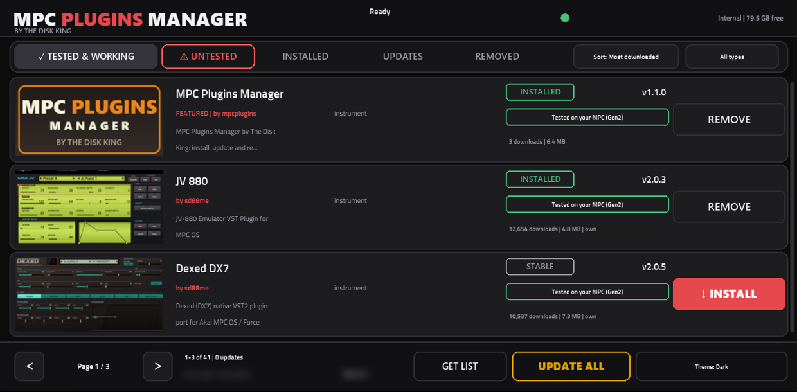

# MPC Plugins Manager

**by The Disk King** · [thediskking.com/plugins/manager](https://thediskking.com/plugins/manager/)

Install, update, remove and restore free plugins **right on your Akai MPC's screen**. No computer needed.

**Version 1.3.0** · works on every MPC (Gen1 and Gen2) · step-by-step install below.

- **Tested & Working first.** Plugins whose makers tested the current version on *your* kind of MPC (Gen1 or Gen2) are on the first tab. Untested and beta plugins are kept apart, behind a red warning and a second tap.
- **Big cards** with a screenshot, description, downloads, size, badge, version and tested status. **Roll your finger to scroll**; pages of 20, arrows for the next 20, Q-Link 1 too.
- **Tap a plugin's picture for its details page:** big screenshot, full description, what's new, version history, what it needs, and the install button always there.
- **Follow your favorite makers (new in 1.3.0).** Tap **FOLLOW MAKER** on a plugin's details page: their new plugins and new versions then come first in the list, marked **NEW**, until you open or install them. TYPE > Followed shows everything from the makers you follow.
- **Featured picks first**, then plugins with real pictures.
- **One button per plugin** that does the right thing: INSTALL, UPDATE, REMOVE or RESTORE.
- **UPDATE ALL** in one tap. Your own files (ROMs, presets, patterns) are kept on every update.
- **Undo anything.** REMOVE moves a plugin to a *Removed Plugins* folder; RESTORE puts it back.
- **Checked downloads.** Every file comes straight from its maker's GitHub over HTTPS and must match its SHA-256 checksum before anything is copied.
- **Works with more plugins.** Releases made before MPC OS 3.10.1 that lack a `plugin.json` are installed too: the manager writes the `plugin.json` from the release's own details.
- **10 color themes that change live.** Disk King (default), Light, Dark, Midnight, MPC Red, Studio Green, Ocean, Purple Haze, Sunset, High Contrast. Tap THEME and the screen switches at once.
- **Optional phone page.** Browse from a phone or computer on the same Wi-Fi, protected by a 4-digit PIN shown on the MPC.
- **Only touches what it should.** It writes inside `VST2 Plugins`, its own `MPC Plugins Manager` folder, and its own screen files. No system changes.

The plugin list is the one at [thediskking.com/plugins](https://thediskking.com/plugins/), checked every night.

## Install

1. Your MPC needs **MPC OS 3.10.1 or later**. Turn on **Menu → Preferences → Enhancements → Enable Enhancements** and **External Plugin Support**, wait a few seconds, then restart.
2. Click the **DOWNLOAD** button at the top of this page. A file called `MPC-Plugins-Manager-1.3.0-mpc-sdk.zip` lands in your **Downloads** folder (older versions: [Releases](../../releases)).
3. Unzip it (Windows: right-click the file, then **Extract All**; Mac: double-click it). Connect the MPC to the computer with its USB cable in **Computer Mode** and copy the folder **`The Disk King - VST - MPC Plugins Manager`** into a folder named **`VST2 Plugins`** on the MPC's internal drive or a USB stick. Restart the MPC.
4. Add a **Plugin** track, choose **External Plugins → The Disk King → MPC Plugins Manager**, then tap the **arrow** next to the plugin name to open its screen.

Full guide: [How to install plugins on MPC OS 3.10.1](https://thediskking.com/plugins/install/).

**Plugin storage tip:** plugins can't run from drives the MPC mounts "noexec", which includes many external SSDs. The internal drive is the safest place.

## Updates

Every version is listed with its notes in [CHANGELOG.md](CHANGELOG.md) and on the [Releases](../../releases) page.

## Disclaimer

Plugins listed by the manager are made by independent developers and downloaded from their own GitHub pages. MPC Plugins Manager and the plugins are provided as is, with no warranty. The Disk King is not responsible in any way for any damage or loss. Save your work and back up before installing any plugin. Not affiliated with Akai Professional or inMusic. MPC and Force are their trademarks.

Copyright (c) 2026 The Disk King. All rights reserved. Built with Akai's MPC Plugin SDK (MIT).
